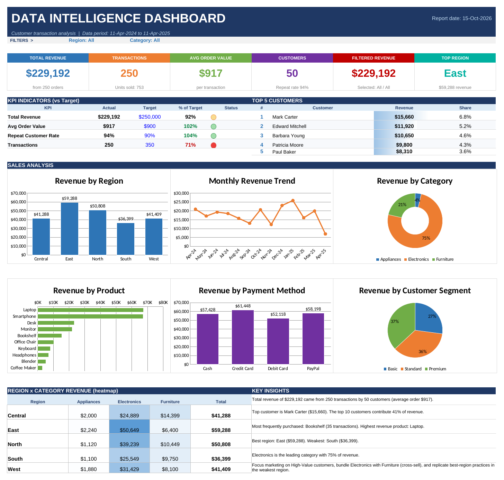
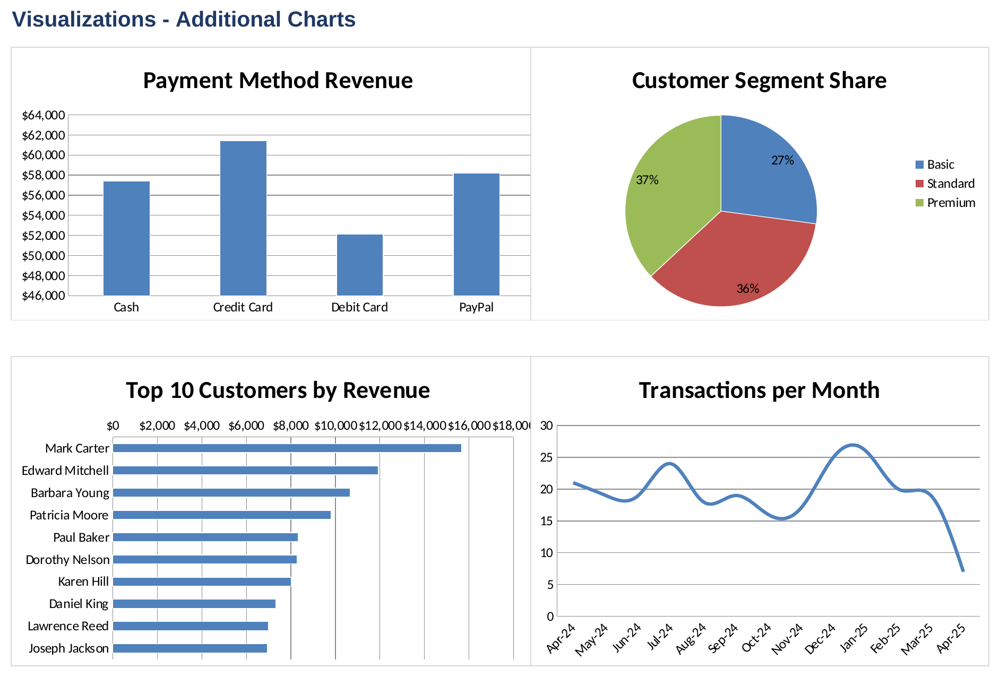
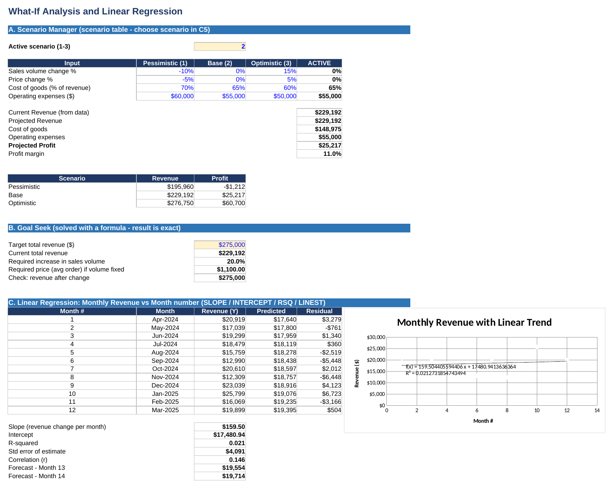
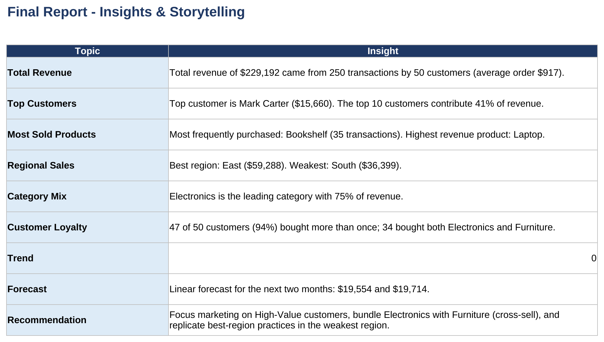
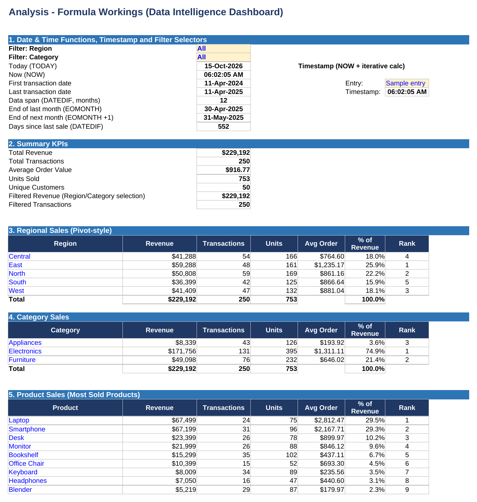
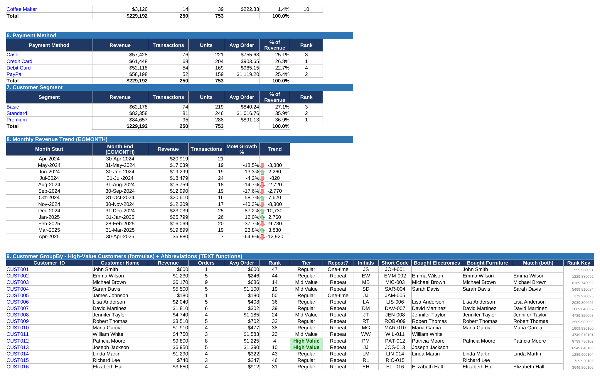
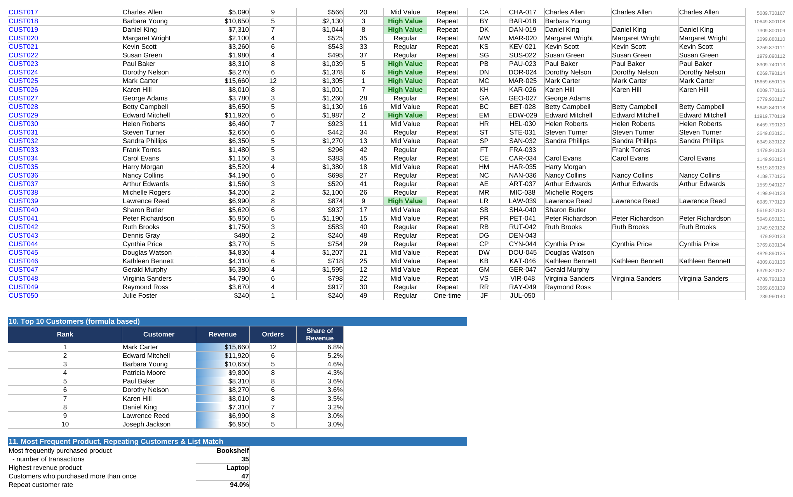
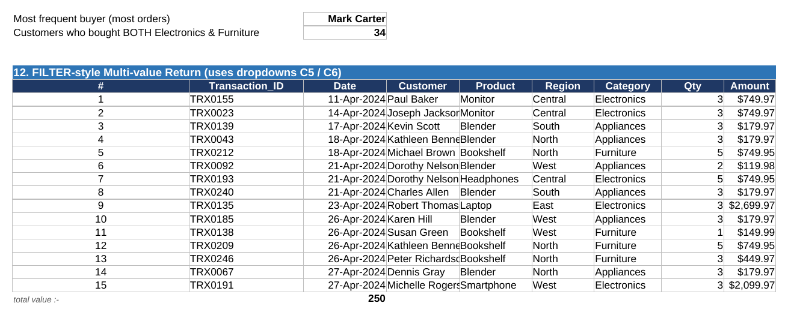

<div align="center">

# 📊 Data Intelligence Dashboard

### Transforming Customer Transactions into Business Insights

An end-to-end **Microsoft Excel analytics project** featuring an interactive dashboard, KPI tracking, customer and sales analysis, What-If scenarios, linear regression, and a final insights report.

<br>


<br>

**📌 Explore the dashboard • Discover patterns • Support data-driven decisions**

</div>

---

## 📚 Table of Contents

- [Project Overview](#-project-overview)
- [Dashboard at a Glance](#-dashboard-at-a-glance)
- [Project Objectives](#-project-objectives)
- [Workbook Structure](#-workbook-structure)
- [Dataset Overview](#-dataset-overview)
- [Tools and Techniques](#-tools-and-techniques)
- [Visual Gallery](#-visual-gallery)
- [Key Business Insights](#-key-business-insights)
- [What-If Analysis and Regression](#-what-if-analysis-and-regression)
- [Recommendations](#-recommendations)
- [How to Explore the Project](#-how-to-explore-the-project)
- [Skills Demonstrated](#-skills-demonstrated)
- [Author](#-author)

---

## 🧭 Project Overview

The **Data Intelligence Dashboard** is a spreadsheet-based business analytics project built to turn customer transaction records into meaningful, decision-ready information.

The workbook brings together transaction data, calculated KPIs, regional and category comparisons, customer-level analysis, visual storytelling, scenario planning, and a final report. The goal is to make business performance easier to understand and help identify areas that deserve attention.

> 💡 **Project focus:** Sales performance, customer behaviour, product performance, regional revenue, payment methods, and scenario-based business planning.

---

## 📊 Dashboard at a Glance

<div align="center">



</div>

### Core Performance Metrics

| Metric | Workbook Result |
|:--|--:|
| 💰 Total Revenue | **$229,192** |
| 🧾 Transactions | **250** |
| 🛍️ Average Order Value | **~$917** |
| 👥 Unique Customers | **50** |
| 📦 Units Sold | **753** |
| 🔁 Repeat Customer Rate | **94%** |
| 🏆 Highest-Revenue Region | **East — $59,288** |
| ⭐ Highest-Revenue Product | **Laptop** |

<sub>Figures are based on the workbook's current calculations and may be rounded for readability.</sub>

---

## 🎯 Project Objectives

- 📈 Measure overall sales and transaction performance.
- 🌍 Compare revenue across regions and product categories.
- 🛒 Identify high-performing products and frequently purchased items.
- 👥 Examine customer value, repeat purchases, and top customers.
- 💳 Compare sales by payment method and customer segment.
- 🎛️ Use filter selectors to explore regional and category results.
- 🧪 Evaluate alternative business assumptions using What-If Analysis.
- 📉 Explore monthly revenue using a linear regression model.
- 📝 Communicate findings through a concise, insight-focused report.

---

## 🗂️ Workbook Structure

| Workbook Area | Purpose |
|:--|:--|
| **Raw Data / Dataset** | Source transaction records used throughout the analysis |
| **Dashboard** | KPI cards, filters, charts, regional heatmap, and key insights |
| **Visualizations** | Additional charts for payment methods, customer segments, top customers, and monthly transactions |
| **Analysis** | Formula-driven KPIs, regional/category/product summaries, customer grouping, monthly trends, and transaction filtering |
| **What-If & Regression** | Scenario comparisons, goal-seek calculations, regression outputs, residuals, and forecasts |
| **Final Report** | Business insights and recommendations in a presentation-friendly format |

### 📁 Suggested Repository Layout

Keep the files organized like this so all screenshot links work correctly on GitHub:

```text
Data-Intelligence-Dashboard/
├── Data_Intelligence_Dashboard.xlsx
├── Project_Dataset.xlsx
├── README.md
└── screenshots/
    ├── dashboard.png
    ├── additional-visualizations.png
    ├── what-if-regression.png
    ├── final-report.png
    ├── analysis-overview.png
    ├── customer-analysis.png
    ├── customer-insights.png
    └── filtered-transactions.png
```

---

## 🧾 Dataset Overview

The project dataset contains **250 transaction records** and the following 14 fields, as documented in the workbook.

| Field | Description |
|:--|:--|
| `Transaction_ID` | Unique transaction identifier |
| `Date` | Date of the transaction |
| `Customer_ID` | Customer identifier |
| `Customer_Name` | Customer name |
| `Product_ID` | Product identifier |
| `Product_Name` | Purchased product |
| `Category` | Product category |
| `Quantity` | Number of units purchased |
| `Unit_Price` | Price per unit |
| `Payment_Method` | Payment method used |
| `Region` | Sales region |
| `Customer_Segment` | Customer segment |
| `Customer_Since` | Start date of the customer relationship |
| `Total_Amount` | Total transaction value |

---

## 🧰 Tools and Techniques

| Tool / Technique | How It Is Used |
|:--|:--|
| **Microsoft Excel** | Analysis, reporting, and dashboard development |
| **Formulas and Functions** | KPI calculations, summaries, rankings, and customer metrics |
| **Date & Time Functions** | Date spans, month-end calculations, timestamps, and elapsed days |
| **Dropdown Filters** | Region/category selection and filtered transaction views |
| **Charts & Data Visualization** | Comparing sales, trends, product performance, and customer segments |
| **Conditional Formatting** | Visual emphasis for selected metrics and heatmap comparisons |
| **What-If Analysis** | Pessimistic, base, and optimistic business scenarios |
| **Goal Seek-style Calculation** | Estimating the change needed to reach a revenue target |
| **Linear Regression** | Exploring monthly revenue trend, model fit, residuals, and forecast values |
| **Business Reporting** | Translating calculations into findings and recommendations |

---

## 🖼️ Visual Gallery

### 01 — Main Dashboard

The main dashboard combines performance indicators with sales and customer visuals in one place.

<div align="center">

</div>

### 02 — Additional Visualizations

Additional charts highlight revenue by payment method, customer segment share, top customers, and transactions per month.

<div align="center">

</div>

### 03 — What-If Analysis & Linear Regression

Scenario planning compares pessimistic, base, and optimistic assumptions. The regression section explores the monthly revenue trend and displays model outputs.

<div align="center">

</div>

### 04 — Final Report: Insights & Storytelling

The report presents key findings in a concise format intended to connect the numbers with business decisions.

<div align="center">

</div>

### 05 — Formula-Driven Analysis

The analysis sheet contains date functions, summary KPIs, regional and category sales, product performance, payment method results, customer segmentation, and monthly trends.

<details>
<summary><strong>🔎 View analysis overview</strong></summary>
<br>
<div align="center">

</div>
</details>

<details>
<summary><strong>👥 View customer analysis</strong></summary>
<br>
<div align="center">

</div>
</details>

<details>
<summary><strong>📋 View customer insights and rankings</strong></summary>
<br>
<div align="center">

</div>
</details>

<details>
<summary><strong>🧾 View filtered transaction records</strong></summary>
<br>
<div align="center">

</div>
</details>

---

## 🔍 Key Business Insights

The workbook's current dashboard and report highlight the following:

| Area | Finding |
|:--|:--|
| **Overall Performance** | $229,192 in revenue across 250 transactions |
| **Customer Activity** | 50 customers; 47 customers made more than one purchase |
| **Regional Performance** | East is the highest-revenue region at $59,288 |
| **Opportunity Region** | South has the lowest regional revenue at $36,399 |
| **Category Mix** | Electronics contributes approximately 74.9% of revenue |
| **Product Performance** | Laptop has the highest revenue; Bookshelf is the most frequently purchased product, with 35 transactions |
| **Top Customer** | Mark Carter, with $15,660 in revenue |
| **Customer Concentration** | The top 10 customers contribute approximately 41% of revenue |
| **Cross-Selling** | 34 customers purchased both Electronics and Furniture |
| **Forecast** | The workbook estimates the next two monthly revenue values at $19,554 and $19,714 |

These are the workbook's reported results, not independently validated business forecasts. The regression section shows a low R-squared value, so its forecasts should be treated as exploratory rather than reliable predictions.

---

## 🧪 What-If Analysis and Regression

### Scenario Analysis

Three scenarios are included to test how different assumptions may affect projected revenue and profit.

| Scenario | Sales Volume Change | Price Change | Cost of Goods (% Revenue) | Operating Expenses |
|:--|--:|--:|--:|--:|
| Pessimistic | -10% | -5% | 70% | $60,000 |
| Base | 0% | 0% | 65% | $55,000 |
| Optimistic | +15% | +5% | 60% | $50,000 |

### Goal Seek-Style Calculation

The workbook also calculates the sales-volume increase or average order value required to reach a target total revenue of **$275,000**, while showing a check against the target.

### Linear Regression

The regression section models monthly revenue against month number and includes predicted values, residuals, slope, intercept, R-squared, correlation, and two forecast values.

> ⚠️ **Interpretation note:** A low R-squared means the linear model explains only a small share of the variation in monthly revenue. Use the forecast as a learning and analysis exercise, not as a guarantee of future performance.

---

## 💡 Recommendations

- 🎯 Investigate why the South region has lower revenue and compare its performance with the East region.
- 💻 Monitor the availability and performance of high-revenue products such as Laptops and Smartphones.
- 🤝 Retain high-value and repeat customers through targeted engagement and loyalty activities.
- 📦 Test Electronics–Furniture bundles to explore cross-selling opportunities.
- 📊 Review the dashboard periodically and compare actual results with targets.
- 🧪 Use scenario analysis to understand how changes in volume, pricing, costs, and expenses could affect profitability.

---

## 🚀 How to Explore the Project

1. **Download or clone** this repository.
2. Open `Data_Intelligence_Dashboard.xlsx` in **Microsoft Excel**.
3. Review the source records in the dataset/raw-data area.
4. Explore the **Analysis** sheet to inspect formulas, summaries, customer metrics, and monthly trends.
5. Open **Dashboard** and use the available region/category filters.
6. Review **What-If & Regression** to compare scenarios and inspect the regression outputs.
7. Finish with the **Final Report** for the summarized insights and recommendations.


---

## 🌟 Skills Demonstrated

`Data Analysis` · `Excel Formulas` · `KPI Development` · `Dashboard Design` · `Data Visualization` · `Customer Analysis` · `Sales Reporting` · `Scenario Analysis` · `Linear Regression` · `Business Storytelling`

---

## 👨‍💻 Author

<div align="center">

### **Swayam Vekariya**

*Aspiring Data Analyst | Turning raw data into meaningful insights.*

📊 **Analyze thoughtfully. Visualize clearly. Decide confidently.**

</div>

---

<div align="center">

⭐ If you find this project useful or inspiring, consider giving the repository a **star**!

</div>
